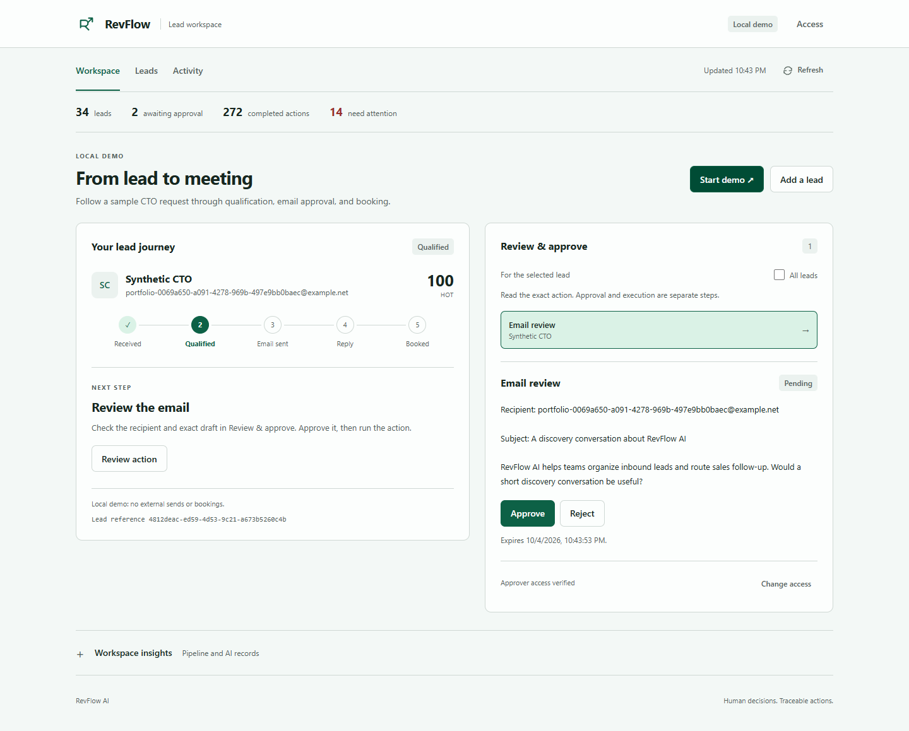
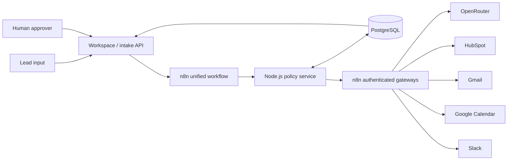

# RevFlow AI

**An AI lead-to-revenue system with deterministic controls, human approvals, and an auditable action ledger.**

[](https://github.com/tarekamr737/revflow-ai/actions/workflows/ci.yml)
[](LICENSE)
[](package.json)

RevFlow AI turns inbound sales requests into qualified leads, reviewed outreach, and scheduled meetings. n8n orchestrates the journey; a Node.js policy service enforces business rules and stores canonical state in PostgreSQL. Models extract signals and draft content. Code computes scores, authorizes actions, and prevents duplicate effects.



*Recorded synthetic workspace. Interface wording has evolved since this screenshot.*

## What it does

- **Qualify and route:** validate and deduplicate inbound events, enrich company data, extract schema-constrained signals, and compute a configurable 0–100 lead score.
- **Sync CRM:** create or reuse HubSpot companies, contacts, and open deals. Reconcile stale synthetic company references through recorded repair actions.
- **Review outreach:** draft from approved sales knowledge, enforce consent and claim checks, and bind protected approvals to exact content and recipient.
- **Handle replies:** route meeting requests to scheduling, product questions to a representative task, and unsubscribe requests to an immediate outreach stop.
- **Book meetings:** propose available times, request a separate approval, recheck availability, and record the booking once.
- **Recover and audit:** reserve action keys before effects, retry eligible transient failures, quarantine uncertain writes, and record events with correlation IDs.

## Project status

| Area | Verified scope |
|---|---|
| Local application | 72 automated tests; synthetic lead-to-meeting flow with mock integrations |
| Unified n8n workflow | 85 validated nodes, deterministic MCP fixtures, 29 credential bindings in the development deployment |
| Connected integrations | HubSpot, Gmail, Google Calendar, Slack, and model calls verified with synthetic data |
| Latest recovery | Same stalled lead recovered to one email approval; one completed contact/deal; no email sent |
| Remaining cutover | Complete all three connected scenarios on the unified canvas and retire the former workflows |

The current runtime targets one `revflow_lead_to_revenue` canvas. Historical modular workflow sources and evidence are retained. Automatic schedules and Gmail polling remain paused in the recorded deployment. This is a working engineering project; deployment to another account requires its own credentials and validation.

## Quick start

**Requirements:** Node.js 22 or later and npm. No provider accounts, API keys, or Docker are needed for the local demo.

```bash
git clone https://github.com/tarekamr737/revflow-ai.git
cd revflow-ai
npm ci
npm run db:migrate
npm start
```

Open **http://127.0.0.1:3100**. Local development uses PGlite, a PostgreSQL-compatible embedded engine, and mock adapters. Data is stored in `.data/dev`; integrations produce recorded mock effects.

1. Select **Meeting request** and click **Start workflow**.
2. Open the email review, check its content, and **Approve → Run action**.
3. Click **Process reply**, choose an available time, and review the booking.
4. **Approve → Run action** again, then inspect **Activity** and the recorded meeting result.

In the unauthenticated loopback-only mock mode, local approvals are enabled automatically. Authenticated deployments require separate workspace and approver tokens. Tokens remain in page memory and clear on reload.

For a terminal-only walkthrough:

```bash
npm run demo
```

Run the app and demo separately when they use the same PGlite directory. `npm run demo` writes a synthetic result to `docs/demo-result.json`. The three scenarios are described in the [presentation guide](docs/presentation-guide.md).

### PostgreSQL and Docker

With Docker Desktop and PowerShell available, run from the repository root:

```powershell
powershell.exe -NoProfile -ExecutionPolicy Bypass -File scripts/docker-smoke.ps1
```

This creates development secrets in process/container environment, starts PostgreSQL 17 and the policy app, applies four immutable migrations, and checks authenticated approval and booking. The runtime database role is restricted; migrations run under a separate owner. The dashboard remains at port **3100**; local n8n is available at **5678**.

Run this smoke setup before opening a connected session. Use one runtime on port 3100 at a time. For explicit Compose configuration, copy [.env.example](.env.example) to an ignored `.env` and fill its required secrets locally.

## Architecture



The policy service owns validation, scoring, permission checks, transactions, and action receipts. n8n owns sequencing and authenticated provider calls. Approvals and replies resume through separate triggers on the same canvas, so a complete journey spans multiple executions.

See [architecture and ADRs](ARCHITECTURE.md) for stage contracts, state transitions, and recovery decisions.

## Connected operation

Connected operation requires your own n8n deployment, authorized provider accounts, internal authentication credentials, and an HTTPS route to the policy service. The included workflow SDK sources and historical account IDs are reference artifacts; they do not provision credentials or grant access to the recorded deployment.

1. Copy [config/n8n.example.json](config/n8n.example.json) to ignored `config/n8n.json`; set your instance, deployed workflow ID, and webhook prefix.
2. Create and bind the credentials described in [credential setup](docs/credentials.md). Create, update, validate, and test workflows through n8n MCP.
3. Run happy and failure fixtures before enabling inbound triggers. Verify PostgreSQL events, protected approvals, and duplicate suppression against your own accounts.
4. For the Windows session helper, place `cloudflared.exe` in ignored `.tools/`, then start the connected session:

```powershell
$revflowInbox = Read-Host 'Test inbox address'
powershell.exe -NoProfile -ExecutionPolicy Bypass -File scripts/start-connected.ps1 -TestRecipient $revflowInbox
```

The helper registers an expiring HTTPS policy endpoint and renews its lease while your PC is running. Synthetic CRM records remain synthetic; approved email delivery and calendar attendees use the configured test inbox. Stop the session when finished:

```powershell
powershell.exe -NoProfile -ExecutionPolicy Bypass -File scripts/stop-connected.ps1
```

Real-contact operation requires an explicit recipient allowlist, approved sales knowledge, and acknowledgment of model data handling. Every personal outbound email requires approval. Personal startup is blocked while synthetic execution tracing is enabled. See [personal operation](docs/personal-use.md).

## Security and reliability

- **Separate roles:** workspace, approver, inbound, and gateway credentials have distinct purposes. Production requires strong, separate secrets.
- **Authenticated intake:** signed webhooks use HMAC-SHA256, a five-minute timestamp window, single-use nonces, and a 64 KB body limit.
- **Bounded AI:** lead text is untrusted data. Versioned prompts and independent schema checks constrain model outputs; low confidence and invalid outputs stop automation.
- **Consent and approvals:** no outreach without consent; opt-out cancels follow-ups. Protected email and booking actions require exact-payload review. Follow-ups are capped at three.
- **Idempotency:** unique action reservations and saved receipts protect CRM writes, sends, and bookings. Ambiguous writes require reconciliation.
- **Recovery:** transient failures use bounded backoff; permanent failures enter a dead-letter path. Alert failures cannot recurse indefinitely.
- **Private configuration:** secrets, databases, caches, tunnels, local account settings, and recipient lists are excluded from Git. Authenticated n8n gateway payload retention is disabled.

See [SECURITY.md](SECURITY.md) for vulnerability reporting and configuration boundaries. Historical synthetic evidence is retained for inspection; account-specific IDs are not portable deployment configuration.

## Tests and evaluation

```bash
npm test
npm run check
npm run eval
npm run eval:replay
```

The suite covers qualification, policy gates, approval replay, concurrent reservations, retries, opt-out, Gmail thread matching, calendar conflicts, recipient changes, stale CRM recovery, and dashboard processing states. CI runs clean-install checks on Linux and Windows without external provider credentials.

Evaluation stops before CRM, email, and booking. Its **240 synthetic cases come from 15 template families**; they are regression fixtures, not independent real-world validation.

| Evaluation | Prompt | Intent Macro-F1 | Schema validity | Label-route agreement |
|---|---|---:|---:|---:|
| Deterministic fixture adapter | qualification-v1 | 0.8815 | 100% | 86.67% |
| Deterministic fixture adapter | qualification-v2 | 0.9259 | 100% | 93.33% |
| Historical recorded model responses | qualification-v1 | 1.0000 | 100% | 100% |
| Historical recorded model responses | qualification-v2 | 1.0000 | 100% | 95% |

The historical model comparison used `stealth/space-bunny-alpha`: **112 live semantic requests**, followed by exact-response replay through the qualification/scoring service. Its results do not benchmark the currently configured `nvidia/nemotron-3-super-120b-a12b:free` model. Human qualification agreement remains unmeasured; missing provider cost remains unreported.

Evidence: [mock evaluation](evaluation/results.json), [recorded model evaluation](evaluation/results-recorded-live.json), [historical verification](docs/verification.json), and [latest CRM recovery](docs/crm-recovery-fix.json).

## Repository guide

| Path | Contents |
|---|---|
| `src/` | Policy API, adapters, schemas, deterministic rules, and action ledger |
| `dashboard/` | Lead journey, approval review, and audit interface |
| `workflows/` | n8n SDK sources, logical specifications, and recorded MCP evidence |
| `database/` | Immutable migrations and synthetic/configuration seeds |
| `prompts/` | Versioned qualification, drafting, and reply prompts |
| `evaluation/` | Synthetic cases, metrics, and recorded response replay |
| `tests/` | Policy, integration, security, and dashboard regression tests |
| `scripts/` | Local setup, Docker smoke, connected sessions, and verification |
| `docs/` | Operational guides and scoped verification records |

Contributions follow [CONTRIBUTING.md](CONTRIBUTING.md). Licensed under the [MIT License](LICENSE).
